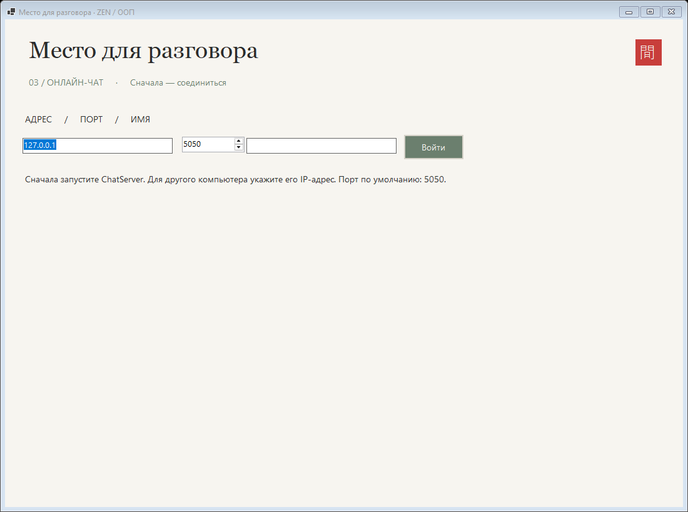

# Онлайн-чат

Автор: ФИО студента не предоставлено; реализация подготовлена с помощью Codex. Перед сдачей укажите реальные ФИО и вклад участников.

## Запуск

Windows + .NET 8 SDK. Из корня репозитория:

```powershell
dotnet run --project lab3-chat/Chat.csproj
```



## Управление и устройство

Сначала запустите сервер отдельной командой из корня:

```powershell
dotnet run --project lab3-chat/server/Server.csproj -- 5050
```

Затем запустите несколько клиентов, укажите IP сервера, порт 5050 и разные имена. Для локальной проверки IP — `127.0.0.1`. Enter и кнопка отправляют сообщение. Выберите имя в правом списке для личного сообщения; «Всем» возвращает общую рассылку. После разрыва закройте окно разговора и подключитесь снова из окна входа.

`ChatMessage` кодирует протокол; `ChatServer` обслуживает соединения и историю; `ClientHandler` отвечает за один сокет и сериализацию отправок; `ChatClient` предоставляет события без зависимости от окон; `LoginForm` и `ChatForm` обновляются через BeginInvoke. Доступ к списку клиентов и истории защищён lock, чтение асинхронное. История: `%LOCALAPPDATA%/ZenOop/chat-history.json`.

### Протокол

TCP, UTF-8 без BOM, один JSON-объект на строку, переносы в тексте экранируются JSON. Имена полей при чтении нечувствительны к регистру. Клиент начинает с `{"Type":"login","Nick":"Аня"}`. Ответ — `welcome` либо `error` с `Text`. Далее `text` с `Text` и необязательным `Recipient`. Сервер сам назначает Nick и UTC Time, не доверяя входящим полям. `users` содержит массив Users; `system` — уведомления; `history` — последние 20 публичных сообщений. Личные сообщения получают только отправитель и адресат, на диск они не пишутся. Занятость ника проверяется без учёта регистра. Ник: 1–24 символа, сообщение: 1–4000. Таймаут входа 15 секунд, отправки сервера 3 секунды.

- [x] Отдельные сервер и оконный клиент, ввод IP и порта.
- [x] Уникальный ник и уведомления.
- [x] Лента, время, Enter, актуальный список онлайн.
- [x] Отдельные классы и описанный протокол.
- [x] Фоновая сеть, обработка отключений и недоступного сервера.
- [x] README и скриншот (окно входа).
- [x] ★ Личные сообщения с цветовым выделением.
- [x] ★★ Последние 20 публичных сообщений после перезапуска.
- [ ] Указать двух реальных участников и их вклад перед сдачей.
