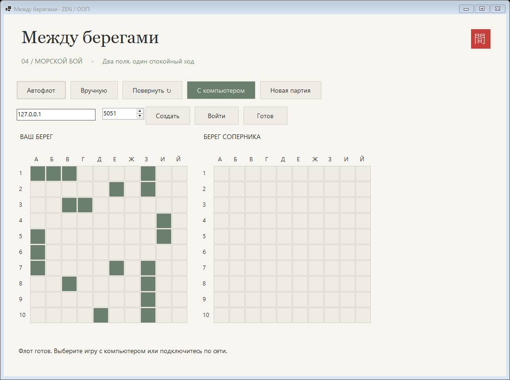

# Морской бой

Автор: ФИО студента не предоставлено; реализация подготовлена с помощью Codex. Перед сдачей укажите реальные ФИО и вклад участников.

## Запуск

Windows + .NET 8 SDK. Из корня репозитория:

```powershell
dotnet run --project lab4-battleship/Battleship.csproj
```



## Управление и устройство

Для сети один игрок нажимает «Создать», другой вводит его IP/порт и нажимает «Войти». После подключения оба нажимают «Готов»; создатель ходит первым. В правом поле выбирается клетка выстрела. После попадания ход сохраняется. Для одиночной игры нажмите «С компьютером».

Автофлот создаётся при запуске. «Вручную» очищает поле: ставьте корабли по порядку 4,3,3,2,2,2,1,1,1,1. «Повернуть» меняет направление; наведением видны допустимость и контур. «Новая партия» сбрасывает оба сетевых поля; затем оба вновь подтверждают готовность. В режиме бота после сброса нажмите «С компьютером». Разорванное соединение требует нового подключения. Ожидание подключения ограничено 60 секундами.

`Board` проверяет границы, состав флота, касание и выстрелы; `Ship` хранит попадания; `Game` хранит `GameState`, собственное поле и известные клетки чужого поля. `Cell` и `ShotResult` — enum; нарушения — `RuleException`. `Player` абстрактный, реализации `LocalPlayer`, `NetworkPlayer`, `BotPlayer`. Окно использует контракт Player без проверки конкретного класса. Бот стреляет в соседние клетки после попадания и исключает окрестность потопленного корабля. `Connection` не знает об окне.

### Протокол

TCP / UTF-8 / один JSON на строку. `ready` — флот готов, `shot` с Position `{X,Y}` — запрос выстрела, `result` с Report `{Result,SunkCells,Defeated}` — ответ владельца поля, `new` — сброс партии. Enum Result: 0 мимо, 1 ранил, 2 убил. Координаты 0–9. По сети отправляются только выстрелы и результат, включая клетки уже потопленного корабля; скрытый флот не передаётся. Одновременно только один запрос выстрела, таймаут ответа 15 секунд. Создатель начинает после двух ready.

- [x] Создание и подключение по сети.
- [x] Два подписанных поля и состояние игры.
- [x] Авторасстановка классического флота без касаний.
- [x] Очередь, повтор после попадания, потопление, окрестность и итог.
- [x] Правила в модели, enum, собственное исключение.
- [x] Обработка ошибок, README, скриншот, протокол.
- [x] ★ Ручная расстановка с поворотом и подсветкой; новая партия.
- [x] ★★ Абстрактный игрок и бот с добиванием.
- [ ] Указать реальных участников пары и вклад перед сдачей.
