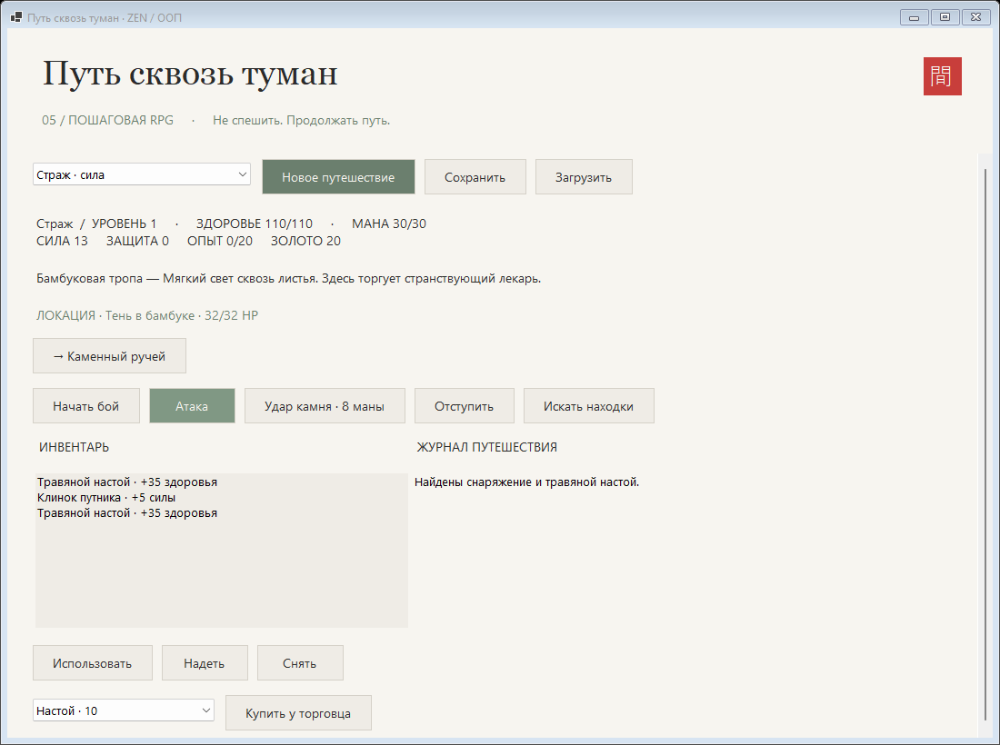
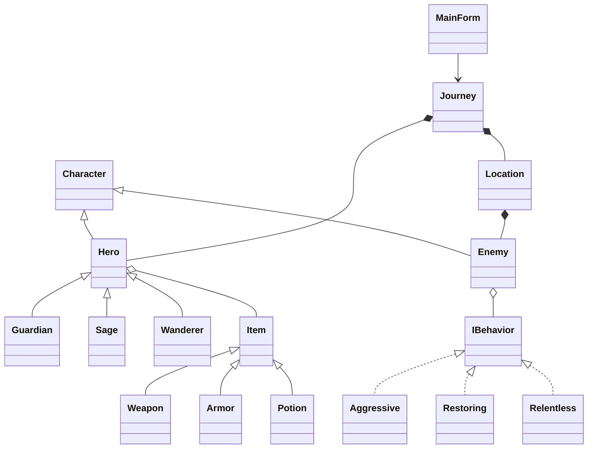

# Путь сквозь туман

Автор: ФИО студента не предоставлено; реализация подготовлена с помощью Codex. Перед сдачей укажите реальные ФИО и вклад участников.

## Запуск

Windows + .NET 8 SDK. Из корня репозитория:

```powershell
dotnet run --project rpg/Rpg.csproj
```



## Управление и устройство

Выберите класс и нажмите «Новое путешествие». Страж наносит двойной удар, Мудрец — тройной магический, Странник лечится и атакует. Ищите находки, надевайте оружие и доспехи, начинайте бой. В бою доступны атака, способность, использование предмета и отступление с ответным ударом. После победы получаются опыт и золото; повышение уровня восстанавливает здоровье/ману и увеличивает характеристики.

Четыре локации соединены последовательным маршрутом. Торговец находится на Бамбуковой тропе. До финального храма нужно победить трёх хранителей. Предметы используются через выделение в инвентаре. Покупка доспеха перед первым боем и найденный клинок облегчают прохождение. Кнопки сохранения и загрузки открывают выбор JSON-файла. Восстанавливаются класс, здоровье, мана, опыт, золото, предметы, экипировка, локация, состояние боя, здоровье врагов и найденные сокровища.

### Классы

`Character` — базовый класс для `Hero` и `Enemy`. `Hero` наследуют `Guardian`, `Sage`, `Wanderer`. `Item` наследуют `Weapon`, `Armor`, `Potion`. `Journey` управляет миром, ходами, наградами и сохранением, `Location` хранит врага, связи и находки. `IBehavior` реализуют `Aggressive`, `Restoring`, `Relentless` (Strategy). `HeroFactory`, `EnemyFactory`, `ItemFactory` — Factory. События `Hero.LevelUp` и `Journey.Happened` — Observer; наличие подписчиков не влияет на игровую логику.



- [ ] Командная сдача: реальные участники, личные коммиты, PR и распределение работы (не предоставлены).
- [x] Три класса героя с различиями.
- [x] Общий базовый класс и три стратегии врагов.
- [x] Бой, платная способность, предмет, побег, гибель.
- [x] Три вида предметов, экипировка и снятие.
- [x] Четыре связанные локации.
- [x] Опыт, уровни, золото и награды.
- [x] JSON сохраняет героя и мир.
- [x] Финальный противник и состояния победы/поражения в окне.
- [x] Недопустимые действия показывают сообщения без закрытия приложения.

Для защиты распределите реальные части по участникам и проверьте понимание кода каждым. История совместной работы и участие в защите не могут быть созданы программной реализацией.
